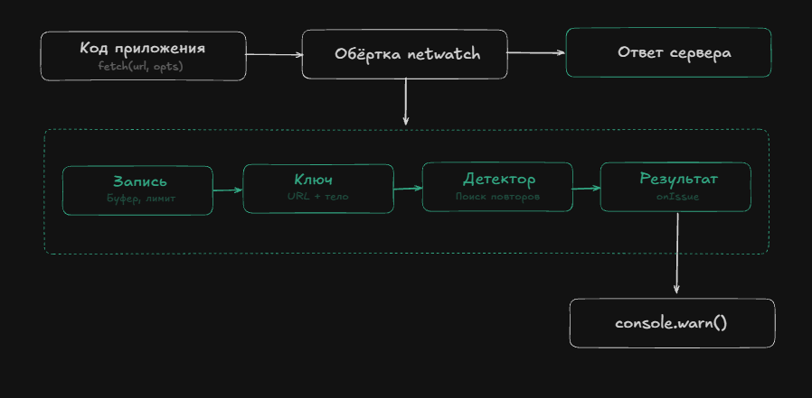

## NPM библиотека для мониторинга API-запросов и обнаружения избыточных сетевых вызовов

[](https://developer.mozilla.org/en-US/docs/Web/JavaScript)

### Что за библиотека?

Библиотека, которая следит за сетевыми запросами в браузере и находит среди них избыточные: дубликаты, повторы без изменений, всплески и запросы, чей результат не пригодился.

### Установка
```
npm install netwatch
```

### Использование
```
import { init } from 'netwatch';

const monitor = init({
  onIssue(issue) {
    console.warn(`[netwatch] ${issue.type}: ${issue.method} ${issue.url}`, issue);
  },
});
```

### Схема работы

